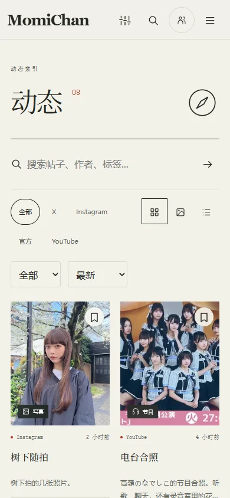

# HmrChan Frontend

<p align="center">
  <a href="https://vuejs.org/guide/"></a>
  <a href="https://www.typescriptlang.org/docs/"></a>
  <a href="https://vite.dev/guide/"></a>
  <a href="public/manifest.json"></a>
  <a href="https://developers.cloudflare.com/pages/"></a>
</p>

<p align="center">
  <strong>简体中文</strong> · <a href="docs/en/README.md">English</a>
</p>

本仓库是 MomiChan 内容社区的 Web 前端，提供动态与照片浏览、作者页面、活动日程、社区讨论和个人收藏。界面支持桌面与移动端、多语言、外观预设和 PWA 安装。

[在线体验](https://momichan.com/) · [快速开始](#快速开始) · [前端架构](docs/zh-CN/architecture.md) · [发布验证](docs/zh-CN/validation.md)

## 界面预览

截图使用项目内置参考数据，展示当前开发版本的桌面首页与移动端动态页。

<table>
  <tr>
    <th>桌面首页</th>
    <th>移动端动态</th>
  </tr>
  <tr>
    <td></td>
    <td></td>
  </tr>
</table>

## 核心功能

| 功能       | 体验                                                 |
| ---------- | ---------------------------------------------------- |
| 内容浏览   | 动态与照片浏览、来源筛选、排序、搜索和作者页面       |
| 活动日程   | 日历与活动列表、日期选择、日程收藏                   |
| 社区互动   | 讨论列表与详情、发布入口、本地草稿恢复               |
| 个人空间   | 登录与账号设置、个人收藏、通知与安全设置             |
| 外观与语言 | 响应式布局、外观预设、明暗主题、多语言与减少动效偏好 |
| PWA        | 安装到桌面、Service Worker、离线回退页面             |

## 快速开始

### 环境要求

| 工具                                                 | 版本要求                     |
| ---------------------------------------------------- | ---------------------------- |
| [Bun](https://bun.sh/docs)                           | 使用 `1.4.4`，最低 `>=1.4.4` |
| [Node.js](https://nodejs.org/docs/latest-v26.x/api/) | `>=26.13.1 <27`              |

运行时要求以 [`package.json`](package.json) 的 `engines` 为准，包管理器版本以 `packageManager` 为准。[`bun.lock`](bun.lock) 是唯一依赖锁文件，请勿混用 npm、pnpm 或 Yarn。

### 启动前端

```bash
git clone https://github.com/domidoremi/hmrchan-frontend.git
cd hmrchan-frontend
bun install --frozen-lockfile
cp .env.example .env.development
bun run dev
```

PowerShell 可使用 `Copy-Item .env.example .env.development` 复制配置。

开发服务器默认从 `http://127.0.0.1:5173` 启动，端口占用时会顺延。如需固定端口，可运行 `bun run dev -- --port 5180`；指定的端口必须可用。

### 后端联调

浏览器始终通过同源 `/api` 请求数据，本地代理默认连接 `http://127.0.0.1:8000`。其他本地上游可通过 `.env.development` 中的 `VITE_API_BASE_URL` 配置。

配套 [hmrchan-backend](https://github.com/domidoremi/hmrchan-backend) 当前为私有仓库，完整联调需要访问权限。按[后端启动说明](https://github.com/domidoremi/hmrchan-backend#简体中文)准备配置并启动 Docker Compose 栈，再启动前端。默认本机上游不可达时，`bun run dev` 会尝试通过本地 API 桥连接已运行的后端容器；后端服务本身需要先启动。

仅查看界面布局时，可以在本地 `.env.development.local` 中设置 `LOCAL_API_AUTO_BRIDGE=false`，跳过 Docker 桥接。完整数据、登录、收藏和发布需要可用的后端 API；公开内容快照用于部分回退场景，未覆盖的页面会显示加载失败或空状态。

## 常用命令

| 命令                             | 用途                               |
| -------------------------------- | ---------------------------------- |
| `bun run dev`                    | 启动本地开发服务器                 |
| `bun run type-check`             | 检查应用、Functions 与 Worker 类型 |
| `bun run lint:strict`            | 执行严格 lint 与注释语言检查       |
| `bun run test:unit`              | 串行执行单元测试                   |
| `bun run build`                  | 生成生产构建                       |
| `bun run build:security-check`   | 检查构建产物                       |
| `bun run audit:docs`             | 检查 Markdown 中的受限地址与路径   |
| `bun run audit:deps`             | 审计依赖漏洞                       |
| `bun run validate:release:local` | 执行本地发布流程                   |

发布模式、证据要求与生产检查以[发布验证文档](docs/zh-CN/validation.md)为准。

## 技术栈与工程设计

| 层次       | 技术                                       |
| ---------- | ------------------------------------------ |
| 应用       | Vue 3、TypeScript、Vite                    |
| 状态与路由 | Pinia、Vue Router、Vue I18n                |
| 边缘部署   | Cloudflare Pages、Pages Functions、Workers |
| 质量工具   | Vitest、ESLint、Prettier、Knip             |

依赖声明与锁定版本见 [`package.json`](package.json) 和 [`bun.lock`](bun.lock)，升级记录与兼容性安排见[技术栈文档](docs/zh-CN/stack-policy.md)。

- **分层缓存：**HTTP、内存、IndexedDB 与 Service Worker 协同处理内容与资源缓存，公共内容使用统一缓存边界和快照回退。实现见 [`src/utils/cache/`](src/utils/cache/)。
- **Service Worker 构建：**自定义 [Vite 插件](build/vite/plugins/serviceWorkerBuild.ts)生成 Service Worker，配合客户端更新协调和离线页面。
- **同源 API：**浏览器使用 `/api` 与 `/ws`，Pages Functions 与内部 Worker 处理上游转发。职责与后端合同见[前端架构](docs/zh-CN/architecture.md)。

## 仓库结构

```text
src/                 Vue 应用、状态、API 边界与单元测试
functions/           同源 Cloudflare Pages Functions
workers/             内部 Cloudflare Worker
build/               Vite 构建插件
scripts/             构建、审计、维护与发布门禁
public/              静态资源与 PWA 文件
docs/images/         README 界面截图
docs/zh-CN/          简体中文文档
docs/en/             English documentation
```

`src/features/` 承载业务界面与交互，`src/views/` 承载其他路由页面。`src/components/` 与 `src/composables/` 提供可复用界面和交互，`src/api/` 与 `src/services/` 管理浏览器集成边界，`src/stores/` 保存跨页面 Pinia 状态。

## 配置

- 环境变量契约见 [`.env.example`](.env.example)
- 浏览器请求默认使用同源 `/api` 门面
- 边缘部署配置位于 [`wrangler.toml`](wrangler.toml)
- 禁止提交本地密钥或机器专属路径

## 文档

- [技术栈版本与升级策略](docs/zh-CN/stack-policy.md)
- [发布验证](docs/zh-CN/validation.md)
- [前端架构](docs/zh-CN/architecture.md)
- [外观预设](docs/zh-CN/appearance-presets.md)
- [English documentation](docs/en/README.md)

## 许可

仓库未声明公开分发许可证，内容仅用于本项目。
