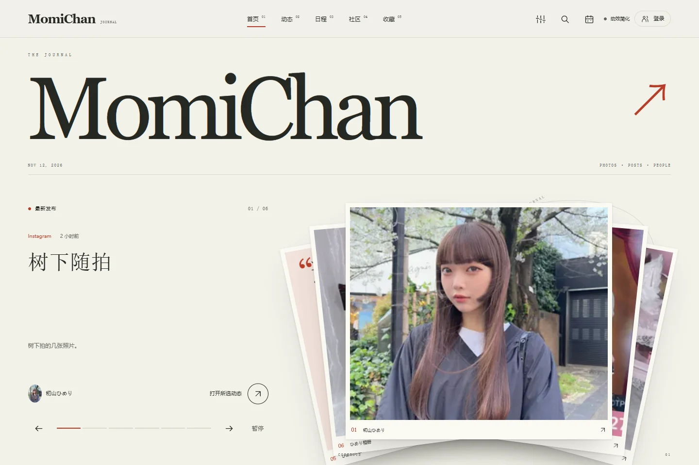
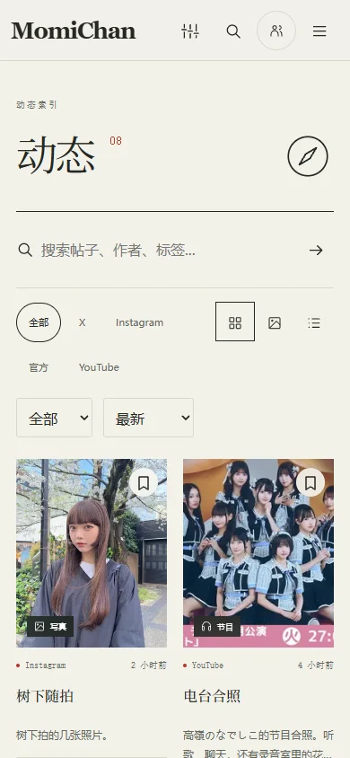

# HmrChan Frontend

<p align="center">
  <a href="https://vuejs.org/guide/"></a>
  <a href="https://www.typescriptlang.org/docs/"></a>
  <a href="https://vite.dev/guide/"></a>
  <a href="../../public/manifest.json"></a>
  <a href="https://developers.cloudflare.com/pages/"></a>
</p>

<p align="center">
  <a href="../../README.md">简体中文</a> · <strong>English</strong>
</p>

This repository is the web frontend for the MomiChan content community. It provides posts and photos, author pages, event calendars, discussions, and personal collections, with desktop and mobile layouts, multiple languages, appearance presets, and PWA installation.

[Live site](https://momichan.com/) · [Quick start](#quick-start) · [Frontend architecture](architecture.md) · [Release validation](validation.md)

## Preview

Screenshots show the desktop home and mobile post browsing in the current development version, using reference data bundled with the project.

<table>
  <tr>
    <th>Desktop home</th>
    <th>Mobile posts</th>
  </tr>
  <tr>
    <td></td>
    <td></td>
  </tr>
</table>

## Features

| Feature                 | Experience                                                                           |
| ----------------------- | ------------------------------------------------------------------------------------ |
| Content browsing        | Posts and photos, source filters, sorting, search, and author pages                  |
| Events                  | Calendar and event lists, date selection, and saved events                           |
| Community               | Discussion lists and details, publishing, and local draft recovery                   |
| Personal space          | Sign-in, account settings, collections, notifications, and security                  |
| Appearance and language | Responsive layouts, presets, light and dark themes, translations, and reduced motion |
| PWA                     | Installation, service worker, and an offline fallback page                           |

## Quick Start

### Requirements

| Tool                                                 | Version requirement            |
| ---------------------------------------------------- | ------------------------------ |
| [Bun](https://bun.sh/docs)                           | Use `1.4.4`; minimum `>=1.4.4` |
| [Node.js](https://nodejs.org/docs/latest-v26.x/api/) | `>=26.13.1 <27`                |

[`package.json`](../../package.json) defines runtime requirements in `engines` and the package manager version in `packageManager`. [`bun.lock`](../../bun.lock) is the authoritative dependency lockfile. Do not mix npm, pnpm, or Yarn with this repository.

### Start the Frontend

```bash
git clone https://github.com/domidoremi/hmrchan-frontend.git
cd hmrchan-frontend
bun install --frozen-lockfile
cp .env.example .env.development
bun run dev
```

In PowerShell, use `Copy-Item .env.example .env.development` to copy the configuration.

The development server starts at `http://127.0.0.1:5173` and uses the next available port if it is occupied. To require a fixed port, run `bun run dev -- --port 5180`; that port must be available.

### Connect the Backend

Browser requests use the same-origin `/api` path. The local proxy targets `http://127.0.0.1:8000` by default; set `VITE_API_BASE_URL` in `.env.development` for another local upstream.

The companion [hmrchan-backend](https://github.com/domidoremi/hmrchan-backend) repository is currently private, so full integration requires access. Follow its [local setup guide](https://github.com/domidoremi/hmrchan-backend#english) to configure and start the Docker Compose stack, then start the frontend. If the default local upstream is unreachable, `bun run dev` attempts to connect to running backend containers through a local API bridge. Start the backend services beforehand.

To inspect layouts, set `LOCAL_API_AUTO_BRIDGE=false` in your local `.env.development.local` to skip the Docker bridge. Full data, authentication, collections, and publishing require working backend APIs. Public snapshots cover some fallback paths; other pages display loading errors or empty states.

## Commands

| Command                          | Purpose                                           |
| -------------------------------- | ------------------------------------------------- |
| `bun run dev`                    | Start the local development server                |
| `bun run type-check`             | Check application, Functions, and Worker types    |
| `bun run lint:strict`            | Run strict lint and comment-language checks       |
| `bun run test:unit`              | Run unit tests serially                           |
| `bun run build`                  | Create the production build                       |
| `bun run build:security-check`   | Inspect generated build output                    |
| `bun run audit:docs`             | Check Markdown for restricted addresses and paths |
| `bun run audit:deps`             | Audit dependency vulnerabilities                  |
| `bun run validate:release:local` | Run the local release workflow                    |

Release modes, evidence requirements, and production checks are defined in the [release validation guide](validation.md).

## Technology and Engineering

| Layer             | Technology                                 |
| ----------------- | ------------------------------------------ |
| Application       | Vue 3, TypeScript, Vite                    |
| State and routing | Pinia, Vue Router, Vue I18n                |
| Edge deployment   | Cloudflare Pages, Pages Functions, Workers |
| Quality tooling   | Vitest, ESLint, Prettier, Knip             |

Dependency declarations and locked versions live in [`package.json`](../../package.json) and [`bun.lock`](../../bun.lock). Upgrade history and compatibility decisions are documented in the [stack guide (Chinese)](../zh-CN/stack-policy.md).

- **Layered caching:** HTTP, memory, IndexedDB, and the service worker handle content and resource caching, with shared public-content cache boundaries and snapshot fallback. See [`src/utils/cache/`](../../src/utils/cache/).
- **Service worker build:** A custom [Vite plugin](../../build/vite/plugins/serviceWorkerBuild.ts) generates the service worker alongside client update coordination and the offline page.
- **Same-origin API:** Browser requests use `/api` and `/ws`; Pages Functions and an internal Worker handle upstream forwarding. See [frontend architecture](architecture.md) for responsibilities and backend contracts.

## Repository Map

```text
src/                 Vue application, stores, API boundaries, and unit tests
functions/           Same-origin Cloudflare Pages Functions
workers/             Internal Cloudflare Worker
build/               Vite build plugins
scripts/             Build, audit, maintenance, and release gates
public/              Static assets and PWA resources
docs/images/         README screenshots
docs/zh-CN/          Simplified Chinese documentation
docs/en/             English documentation
```

`src/features/` owns feature views and interactions; `src/views/` contains other routed pages. Reusable UI and interactions live in `src/components/` and `src/composables/`; browser integration boundaries stay in `src/api/` and `src/services/`; cross-page Pinia state belongs in `src/stores/`.

## Configuration

- Use [`.env.example`](../../.env.example) as the environment-variable contract
- Browser requests use the same-origin `/api` facade by default
- Edge deployment settings are maintained in [`wrangler.toml`](../../wrangler.toml)
- Never commit local secrets or machine-specific paths

## Documentation

- [Stack versions and upgrade policy (Chinese)](../zh-CN/stack-policy.md)
- [Release validation](validation.md)
- [Frontend architecture](architecture.md)
- [Appearance presets](appearance-presets.md)
- [简体中文文档](../../README.md)

## License

No public distribution license is declared. Repository content is maintained for this project only.
